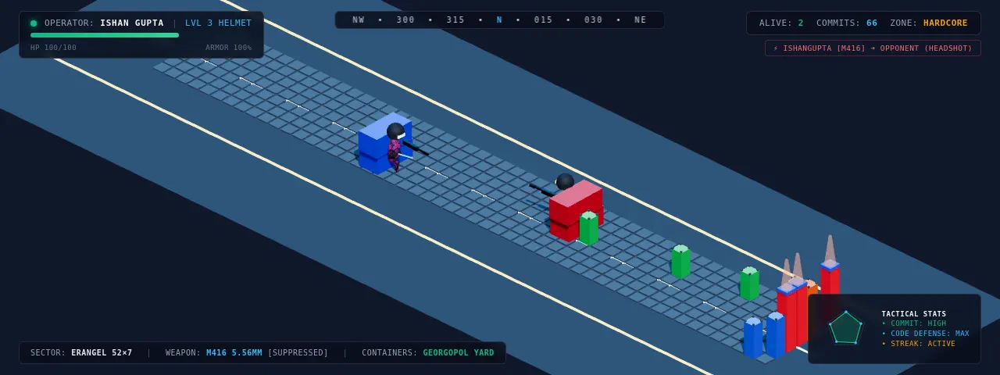

# 3D PUBG GitHub Contribution Battle Arena

<div align="center">
  

  <br/><br/>

  `Three.js (WebGL)` &nbsp;•&nbsp; 
  `Puppeteer (Deterministic 30 FPS)` &nbsp;•&nbsp; 
  `FFmpeg (WebP/GIF Pipeline)` &nbsp;•&nbsp; 
  `GitHub Actions Automation`
</div>

---

## Overview

An automated, end-to-end pipeline that transforms a GitHub contribution calendar into a high-FPS, seamless looping **3D Isometric PUBG-style Battle Arena** (`contrib-battle.webp`).

Your 52×7 GitHub contribution grid is extruded into a tactical Erangel/Pochinki-inspired cover arena. Two rigged Level-3 tactical soldiers take cover behind 3D contribution blocks, peek, and engage in firefights driven by actual commit activity.

---

## Architecture

- **Data Layer**: GitHub GraphQL API (`user.contributionsCollection.contributionCalendar`) fetches 52 weeks × 7 days of commit levels and counts.
- **3D Engine**: Three.js WebGL renderer with ACESFilmicToneMapping, soft shadows, exponential fog, procedural articulated soldier rigs, muzzle flashes, and ricochet sparks.
- **Deterministic Capture**: Puppeteer frame-stepping (`window.seekToTime(t)`) at 1280×480 resolution, 30 FPS, 6-second seamless loop (180 frames) piped into FFmpeg for sub-2MB WebP output.
- **Daily Automation**: GitHub Action `.github/workflows/update-battle-arena.yml` updates the animation every midnight.

---

## Quickstart

```bash
# Clone repository
git clone https://github.com/ishangupta1412/pubg-contrib-arena.git
cd pubg-contrib-arena

# Install dependencies
npm install

# Fetch live contributions and render animation
npm run build
```

---

## Embed in GitHub Profile `README.md`

```markdown
<div align="center">
  <picture>
    <source media="(prefers-color-scheme: dark)" srcset="https://raw.githubusercontent.com/ishangupta1412/pubg-contrib-arena/main/output/contrib-battle.webp">
    
  </picture>
</div>
```
